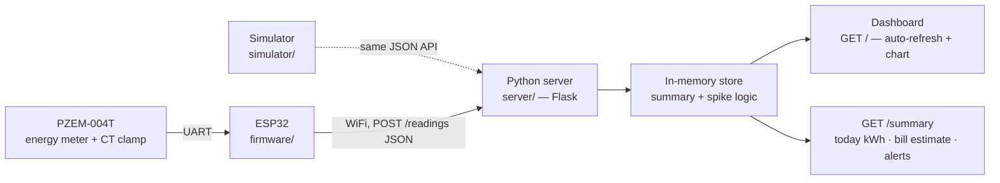

# ⚡ bijli-watch

**Know what your house is consuming — before the bijli bill tells you.**

An ESP32-based home energy monitor for Indian homes: live power (W),
daily consumption (kWh), spike alerts (geyser + AC + iron at once!), and an
estimated monthly bill in ₹ using UP domestic tariff slabs — on a simple
live dashboard you can open on your phone.

No hardware? No problem. A built-in **simulator** generates a realistic
household load pattern, so you can run the whole demo on a laptop.


---

## Why?

In a UP summer the AC runs all afternoon, the geyser fires up in the
morning, and nobody in the house has the faintest idea what that adds up
to — until the bill lands at the end of the month and everyone is shocked.

bijli-watch makes consumption *visible, live*: you see the spike when
three heavy appliances run together, you see what a day actually cost,
and the "estimated monthly bill" number stops being a surprise.

## Architecture



```
bijli-watch/
├── firmware/     ESP32 Arduino sketch (PZEM-004T, WiFi, JSON POSTs)
├── server/       Flask server — ingest, summary, live dashboard
│   ├── tariff.py    UP domestic slab calculation (indicative)
│   ├── logic.py     today-kWh, monthly projection, spike detection
│   └── app.py       HTTP routes + dashboard page
├── simulator/    Fake household that speaks the same API as the ESP32
└── tests/        pytest: tariff, summary/spike logic, HTTP API
```

### Why Flask for the server?

One small readable file, no async or schema framework to learn before
the demo runs, and it serves the dashboard and the JSON API from the same
process. FastAPI would be the pick for a larger typed, multi-client API —
here the real logic deliberately lives in framework-free modules
(`tariff.py`, `logic.py`), so swapping frameworks later is painless.

## Parts list (real hardware, optional)

Approximate prices in India (2026, online) — they move around a lot.

| Part | Approx. price |
|---|---|
| ESP32 DevKit V1 (38-pin) | ₹450–650 |
| PZEM-004T-100A with CT clamp | ₹900–1,300 |
| 5 V USB adapter + micro-USB cable | ₹250–400 |
| Plastic enclosure box | ₹150–300 |
| Jumper wires, misc. | ₹100 |
| **Total** | **≈ ₹1,850–2,750** |

> ⚠️ **Mains safety:** the PZEM measures 230 V AC. Use the CT-clamp
> version, keep mains wiring in a closed enclosure, and get a licensed
> electrician for the mains-side installation. Details in
> [`firmware/README.md`](firmware/README.md).

## Run the demo — WITHOUT any hardware (2 minutes)

```bash
git clone https://github.com/CodewithBull/bijli-watch.git
cd bijli-watch
pip install -r requirements.txt

# Terminal 1 — start the server
python -m server.app
# -> running on http://127.0.0.1:5000

# Terminal 2 — simulate a full household day in about a minute
python simulator/simulator.py --fast --duration 60
```

Then open **http://127.0.0.1:5000** in a browser.

You'll see current power, today's kWh, an estimated monthly bill, and —
when the simulated AC, geyser and iron stack up — a red spike alert.
The dashboard auto-refreshes every 5 seconds.

Normal-speed simulation (real clock, one reading every 5 s):

```bash
python simulator/simulator.py --server-url http://127.0.0.1:5000 --interval 5
```

API, for the curious:

```bash
curl http://127.0.0.1:5000/summary
curl "http://127.0.0.1:5000/readings?limit=5"
curl -X POST http://127.0.0.1:5000/readings -H 'Content-Type: application/json' \
  -d '{"power_w": 1450, "voltage_v": 231, "current_a": 6.28, "energy_kwh": 12.3}'
```

### Configuration

| Env variable | Default | Meaning |
|---|---|---|
| `BIJLI_SPIKE_THRESHOLD_W` | `4000` | Power above this (W) = spike alert |

## Flash the real ESP32

Full steps and the wiring diagram are in
[`firmware/README.md`](firmware/README.md). In short:

1. Arduino IDE + ESP32 board core + **ArduinoJson** library
   (optionally **PZEM004Tv30** for a real sensor).
2. Edit the clearly-marked CONFIG block at the top of
   `firmware/bijli_watch.ino` — WiFi name/password placeholders and
   your server's LAN IP. **Never commit real credentials.**
3. Upload, open Serial Monitor (115200) — expect `HTTP 201` every 10 s.
4. Without the PZEM library the sketch runs in DEMO mode, so you can
   verify WiFi + server before touching any mains hardware.

## Tariff disclaimer

The bill estimate uses **indicative, approximate UP domestic (UPPCL
LMV-1 style) slabs** implemented in `server/tariff.py`:

| Units (kWh/month) | Indicative rate |
|---|---|
| 0–100 | ₹3.50 /unit |
| 101–150 | ₹4.00 /unit |
| 151–300 | ₹5.00 /unit |
| 301–500 | ₹5.50 /unit |
| Above 500 | ₹6.00 /unit |

Plus an indicative ₹110/month fixed charge and 5% electricity duty.

**These are not official figures.** Tariffs change with UPERC orders and
your real bill depends on sanctioned load, category and subsidies. This
is an estimator to avoid bill shock — cross-check with the current
UPPCL tariff order or your actual bill.

## Tests

```bash
pytest -q
```

Covers the slab/bill maths, today's-kWh calculation (cumulative meter
and power-integration fallback), spike detection, the HTTP API, and the
simulator's load pattern.

## Roadmap

- [ ] SQLite persistence (history across restarts, per-day charts)
- [ ] WhatsApp / Telegram alert when a spike lasts > 10 minutes
- [ ] Per-appliance guessing (NILM-lite) from load signatures
- [ ] Monthly PDF report: your house vs. last month
- [ ] OTA firmware updates for the ESP32
- [ ] Optional MQTT ingest alongside HTTP

## License

MIT — see [LICENSE](LICENSE).
